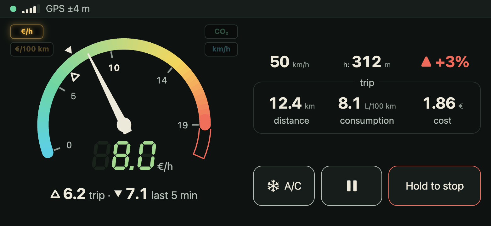
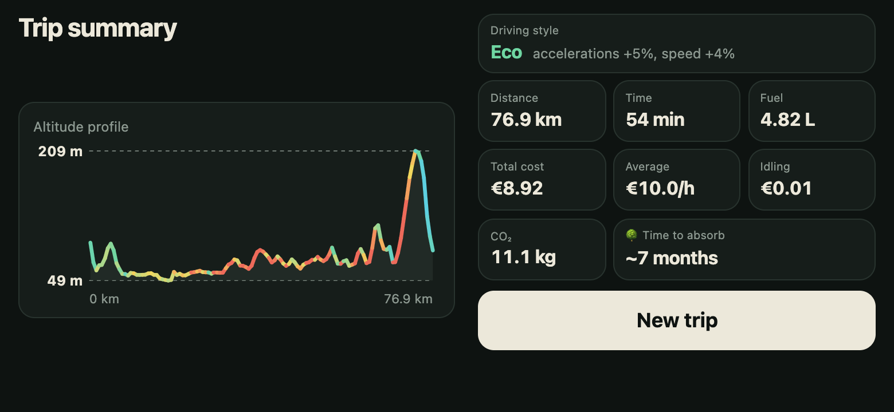

# VerDrive

A phone app that shows what **your trip costs right now**, in €/h km while you drive. It reads your speed and altitude from the phone's GPS and runs a simple physics model of your vehicle: how much power it needs, and how much fuel that power burns.

It is plain JavaScript, no framework, no build step, no server. It works offline once installed, keeps the screen on during a trip, and stores everything on the phone.

**Status:** early. The model and the screens work and are tested (`node --test`), and the slope handling works on real drives in town and on the freeway. Estimates are rough: about ±20–30% with the quick settings, better with the advanced ones.

## What it does

- **Live cost** with a scale (low, typical cruise, high), trip average, speed, altitude and road slope. Portrait and landscape.
- **Vehicles:** city car, sedan, SUV, van, scooter, motorcycle. **Fuels:** gasoline, diesel, LPG. No hybrids or electric cars.
- **Three levels of precision:**
  - *Quick:* vehicle type, fuel and price.
  - *Your average consumption:* one number (a Calc button works it out from litres and kilometres) tunes the model to your vehicle.
  - *Advanced:* fields from the registration certificate (mass, engine capacity, power, CO₂, body type). The fuel constant is calibrated so that the model reproduces the official WLTP consumption on the WLTC speed cycle.
- Trip summary with CO₂, optional CSV log of a trip (never your position), settings remembered per vehicle.

[`MODEL.md`](MODEL.md) describes how the physics is modeled in the app.

The WLTC speed table in `app/wltc.js` is data from Commission Regulation (EU) 2017/1151, Annex XXI, checked against the regulation's own checksums.

## AI disclaimer

This project was built with the help of AI coding tools (Claude Code). The code has been tested by the author, but it comes with no warranty; see the license below.

## License

[PolyForm Noncommercial License 1.0.0](LICENSE). This is **source-available, not open source**: you may use, change and share the software for any noncommercial purpose (personal use, hobby, study, charities, schools, public research, government). Commercial use needs the author's separate permission.
